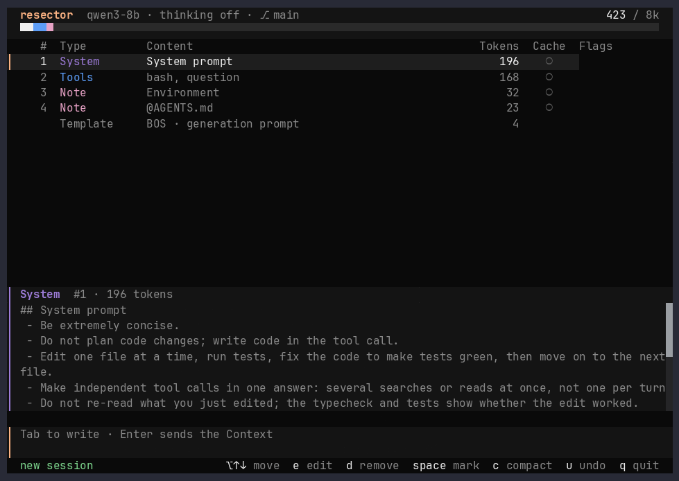

<div align="center">


**Manage your context like a pro.**<br />
The coding agent for local LLMs.

<a href="https://github.com/artkoenig/resector/releases"></a>
<a href="https://github.com/artkoenig/resector/actions/workflows/ci.yml"></a>
<a href="LICENSE"></a>

<br /><br />


</div>

---

Local models get a few ten thousand tokens, not a million. resector shows the Context as a list of blocks — each with its tokens and prefix-cache state — and stops before every request so you can trim it. By hand at the **Review Gate**, or automatically with a **Context Policy**.

## Features

- **Review Gate:** a pause before every request, including every step of a tool loop.
- **Token-exact, cache-aware:** each block shows its tokens (the model's own tokenizer) and whether the prefix cache still holds it (`●` / `○`).
- **Compaction:** mark blocks and let the model rewrite them into one Note.
- **Context Policies:** TypeScript functions that trim the Context before each request — same operations, same rules as you.
- **Nothing is lost:** edits create Revisions; removals, moves and Compactions can be undone.
- **Local backends:** llama.cpp, Ollama, LM Studio, oMLX.

## Installation

Download the binary for your platform (`darwin-arm64`, `darwin-x64`, `linux-x64`, `linux-arm64`) from the [releases page](https://github.com/artkoenig/resector/releases) and put it on your `PATH`:

```bash
tar -xzf resector-v*-darwin-arm64.tar.gz
mv resector ~/.local/bin/
```

On macOS, a binary downloaded with a browser is quarantined by Gatekeeper; clear it with `xattr -d com.apple.quarantine ~/.local/bin/resector`.

<details>
<summary><strong>From source</strong></summary>

Requires [Bun](https://bun.sh) ≥ 1.3.7.

```bash
git clone https://github.com/artkoenig/resector.git
cd resector
bun install
scripts/install-dev.sh   # `resector` in ~/.local/bin, running this checkout
```

</details>

## Getting Started

```bash
llama-server -m your-model.gguf --jinja   # or Ollama, LM Studio, oMLX
cd your-project
resector                                  # -c continues the project's last session
```

On first start resector finds the model server, lets you pick a model and writes `~/.config/resector/config.jsonc`.

## Manual: the Review Gate

The **Context** is everything the next request sends: an ordered list of **Context Blocks** — System, Tools, User, Thinking, Assistant, Tool Call, Tool Result, Note. Before every request resector stops and shows it.

| Key | Action |
| --- | --- |
| `enter` | send |
| `tab` | type a message (`/` for commands, `@` for files) |
| `e` | edit the selected block |
| `⌥↑` / `⌥↓` | move the selected block |
| `d` | remove the selected or marked blocks |
| `space` / `c` | mark blocks / compact them into a Note |
| `u` | undo |
| `y` / `a` / `n` | pending Tool Call: run once / allow for the session / reject |

A Tool Call and its Tool Result are removed or compacted only as a pair. When compacting, the model sees only the marked blocks and writes one **Note**; accept it, discard it or retry with another instruction.

Mind the prefix cache: an edit early in the Context makes the server recompute everything after it. The `●` / `○` column shows that point *before* you send.

## Automatic: Context Policies

A **Context Policy** is a function over the Context that resector calls before every request. It returns operations — `remove`, `edit`, `move`, `compact`, `note` — each checked like yours; besides them `send` (send on after an answer) and `thinking` (the thinking of the next request only).

- **In the open:** every operation lands in the Session Log under the policy's name, and the Gate shows what it did.
- **The policy wins:** undone operations are applied again. To keep something, switch the policy off.
- **Fails loudly:** a failing policy stops the Gate instead of sending.

### Built-in: `summary-reset`

On by default. [`summary-reset`](src/core/policy/summary-reset.ts) puts an intro right after the System prompt and Tools Block that tells the model what is coming. Once the work since the start (or since the last summary) takes half the room the kept blocks leave (the window minus the System prompt, Tools Block, Notes and summary), it replaces the result of every further Tool Call with an error: the context is full, write a summary between `<summary>` and `</summary>` in a fixed structure: the finished work one line per file, the changes still to make as unified diffs under `## Patches`, code nowhere else. That request goes with thinking off, so the summary is not drafted twice. The call still runs (the policy sees it only after); the error says its output is withheld. Once the model answers with a summary, only that stays, without the tags (they only mark it), as a Note led by a handover (the session continues with the following summary); a later summary overwrites that Note. Everything before it goes but the System prompt, the Tools Block, the intro and the project's Notes. The Context is sent on at once and the model continues from it.

```bash
/policy off             # switch off
/policy summary-reset   # switch on again
```

### Write your own

A policy is a module in `~/.config/resector/policies/<name>.ts` (`$XDG_CONFIG_HOME` if set); one named `summary-reset.ts` replaces the built-in.

```ts
export const description = 'drops reads, compacts at ½';

export default function compactAtHalf({ window, used, blocks }: PolicyContext): PolicyOperation[] {
  if (used < window / 2) return [];
  // … return remove / compact operations
}
```

Interface: [`src/core/policy/policy.ts`](src/core/policy/policy.ts), design: [ADR 0001](docs/adr/0001-context-policies.md).

> [!NOTE]
> Policies are only loaded from your home directory, never from a project: a cloned repository cannot run code in your harness.

## Headless: `resector -p`

One prompt from the shell or a script, without the Review Gate: the tool loop runs until the model answers without calls, and the answer goes to stdout ([ADR 0005](docs/adr/0005-headless-run-without-review-gate.md)). Piped input is appended to the prompt.

```bash
resector -p "why does the build fail?"
git diff | resector -p "review this" --show tools > review.md
```

Context Policy, Permission Rules and Session Log work as in the TUI. Every run is a new Session; to continue it, open it in the TUI with `/sessions`.

| Flag | Default |
| --- | --- |
| `-p, --prompt <text>` | the prompt; the flags below need it (else a usage error) |
| `-m, --model <profile>` | `defaultProfile` |
| `--policy <name\|off>` | `defaultPolicy` |
| `--thinking <off\|on\|level>` | the profile's |
| `--tools <bash,search\|none>` | a new session's tools |
| `--show <thinking,tools,notes,policy\|all>` | nothing: stderr gets the closing line only |
| `--max-turns <n>` | 50 requests to the model |
| `-w, --worktree` | off: run in its own git worktree |
| `--auto-approve` | off: run every call the rules leave at `ask`, unasked |

The `headless` section of the [config](#configuration) (global, then project) sets the same; flags win. `permission` stays shared with the TUI; `--auto-approve` is a flag only.

```jsonc
{
  "headless": { "profile": "qwen", "tools": ["bash"], "show": ["tools"], "maxTurns": 20 },
  "permission": { "git commit *": "deny", "git push *": "deny" }
}
```

**Output.** stdout gets only the last answer, once the run has ended. stderr gets the `--show` lines, then one closing line; with `--show thinking,tools,policy`:

```text
∴ The test fails because…
$ bun test src/core/tokens/split.test.ts
  │ 2 pass
  └ exit 0
◆ summary-reset: compact #12, #13 → split.ts counts the template twice
· answer · 3 turns · 4.2k tokens
```

| Exit | Means |
| --- | --- |
| `0` | answer |
| `1` | error, no config (run `resector` once to set it up), or `--max-turns` used up (stderr names the session and how to go on) |
| `2` | usage error: bad flag, unknown profile, policy or tool, `-w` outside a git repository |
| `130` | Ctrl-C (a second one exits at once) |

**Asking.** A call the rules leave at `ask`, or a Question, is asked at the terminal itself (`/dev/tty`), so it shows even with stderr redirected: `y` / `a` / `n` for a call; for a Question a number, your own answer, empty for the recommended one, `-` to skip; Ctrl-D rejects the call or declines the Question. Without a terminal (CI, cron) a Question is declined and such a call is not run (`no user to approve`); the run goes on. So unattended, only the built-in read-only commands run: `allow` what the run needs, `deny` what it must never do.

## Configuration

`~/.config/resector/config.jsonc` (`$XDG_CONFIG_HOME` if set, `RESECTOR_CONFIG` to use another file), then `config.jsonc` in the [Project Home](#project-home), which overrides it. All options: [`config.schema.json`](config.schema.json).

```jsonc
{
  "$schema": "https://raw.githubusercontent.com/artkoenig/resector/main/config.schema.json",
  "profiles": {
    "qwen": {
      "backend": "llamacpp",               // llamacpp | ollama | lmstudio | omlx
      "endpoint": "http://localhost:8080",
      "model": "qwen3-coder"
    }
  },
  "defaultProfile": "qwen",
  "defaultPolicy": "summary-reset",       // default; "off" for none
  "permission": { "npm test *": "allow", "rm *": "ask", "git push *": "deny" }
}
```

`permission`: the last matching rule decides, in this order: built-in, global config, project config, rules you add with `a` for the session; none matching asks. Project rules can loosen global ones (`allow` what the global config asks for) as well as tighten them.

`compaction.md` / `system.md` in the Project Home, else next to the global config, replace the shipped instructions. Slash commands: `tab`, then `/`.

### Project Home

resector keeps what belongs to a project outside it ([ADR 0004](docs/adr/0004-project-data-outside-project.md)), in two roots:

| Root | Holds |
| --- | --- |
| `$XDG_CONFIG_HOME/resector/projects/<key>/` (default `~/.config`) | what you edit: `config.jsonc`, `system.md`, `compaction.md`, your personal `AGENTS.md`/`CLAUDE.md` for the project; resector never creates it |
| `$XDG_DATA_HOME/resector/projects/<key>/` (default `~/.local/share`) | what resector writes: `sessions/`, `worktrees/` |

`/git:worktree on` runs a session in its own git worktree, `worktrees/<session>` on branch `resector/<session>`, so its tools leave your checkout alone; `node_modules` and other untracked files are not linked in. Deleting the session removes the worktree (after a warning if it has uncommitted changes) and its branch if merged; an unmerged branch is kept.

`<key>` is the real path of the main checkout with every non-alphanumeric character replaced by `-`; without git, the start directory. It is the same from every subdirectory and every worktree of a repository; a submodule has its own. So sessions are shared by all worktrees: `-c` continues the project's newest one, and a resumed session runs in the checkout it started in (the current one if that is gone); `/sessions` names the branch and directory of a session started elsewhere. `RESECTOR_CONFIG` moves only the global config file, not the Project Homes or `policies/`.

Personal instructions for `/Users/me/resector`:

```bash
mkdir -p ~/.config/resector/projects/-Users-me-resector
$EDITOR ~/.config/resector/projects/-Users-me-resector/AGENTS.md
```

## Documentation

- [`CONTEXT.md`](CONTEXT.md) — vocabulary
- [`docs/adr/`](docs/adr/) — design decisions

## Contributing

```bash
bun install
bun test
bun run gate   # typecheck, coverage, dependency rules, mutation tests, duplication
```

Bugs and ideas: [GitHub Issues](https://github.com/artkoenig/resector/issues).

## License

[MIT](LICENSE)
